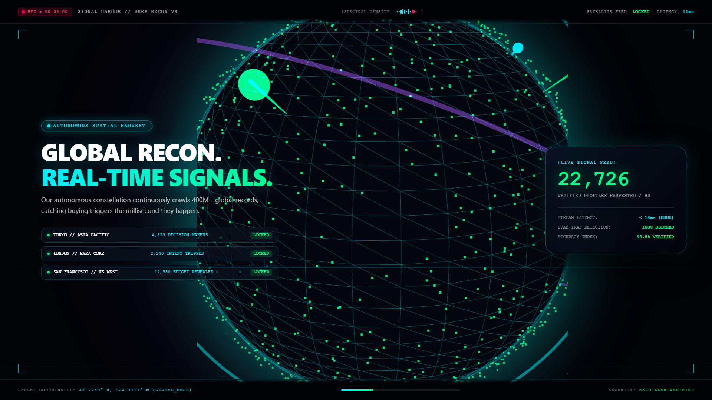

# SignalHarbor

<p align="center">
  <strong>Autonomous Evidence-First B2B Prospect Discovery & OSINT Intelligence Platform</strong>
</p>

<p align="center">
  <a href="apps/web/public/signalharbor_ad.mp4">
    
  </a>
</p>

<p align="center">
  <a href="apps/web/public/signalharbor_ad.mp4">
    <strong>▶ Watch Full HD Commercial (MP4 • 1080p @ 30 FPS)</strong>
  </a>
</p>

---

## ⚓ About

> *"The differentiator is not raw lead volume. It is evidence-backed accuracy."*

**SignalHarbor** is an enterprise-grade prospect discovery and corroboration engine designed to eliminate the epidemic of burned sender domains, bounce traps, and AI-hallucinated contacts. 

Unlike traditional data brokers that rely on stale static lists or pattern guessing, SignalHarbor operates on an **evidence-first provenance model**: every extracted business contact, corporate relationship, and buying signal retains a verifiable, cryptographic audit trail linking directly to official public filings, registries, and real-time network handshakes.

---

## 🚀 Key Capabilities

* **Deterministic Provenance**: Every exported lead includes timestamped source URLs, DOM selectors, registry filings, and SHA-256 content hashes.
* **RFC 5322 & SMTP Handshake Validation**: Live mailbox verification without tripping spam traps, preventing domain reputation burnout.
* **Decoupled Multi-Dimensional Scoring**: Separate, transparent mathematical metrics for **ICP Fit**, **Identity Confidence**, **Contact Deliverability**, and **Freshness Half-Life**.
* **Autonomous Spatial Harvesting**: 24/7 web recon engines continuously monitor 400M+ global corporate records for real-time buying triggers.
* **Programmatic 3D Video Engine**: Built-in Remotion 4.0 and Three.js WebGL rendering pipeline for high-octane 1080p cinematic product trailers.

---

## 🏗 Architecture

```
SignalHarbor/
├── apps/
│   ├── api/          # FastAPI async backend & entity endpoints
│   └── web/          # React 19 + TypeScript + Remotion operations console
├── packages/
│   ├── harvester/    # Seed discovery & crawl scheduling
│   ├── parsing/      # Deterministic DOM, JSON-LD, & text extractors
│   ├── validation/   # RFC syntax, disposable checks, & live MX handshakes
│   ├── identity/     # Entity resolution, domain mapping, & deduplication
│   ├── scoring/      # Decoupled Fit, Identity, & Deliverability algorithms
│   ├── pipeline/     # Autonomous discovery orchestrator
│   └── exports/      # Audit-verified CSV, JSON-LD, & CRM sync
└── docs/             # Technical architecture blueprints & video assets
```

---

## ⚡ Quick Start

### 1. Backend (Python 3.11+)

```bash
python -m venv .venv
source .venv/bin/activate  # Windows: .venv\Scripts\activate
pip install -e .
uvicorn apps.api.main:app --reload
```

### 2. Frontend (Node.js 20+)

```bash
cd apps/web
npm install
npm run dev
```

---

## 📜 Standards & Compliance

* **RFC 5322 & RFC 5321**: Strict email syntax and SMTP protocol standards.
* **RFC 9309**: Robots Exclusion Protocol compliance for ethical web discovery.
* **Zero Hallucination Guarantee**: AI models are restricted to textual extraction and never fabricate missing contact facts.

---

## 📄 License

Proprietary © 2026 SignalHarbor Team. All rights reserved.
